# PROYECTO 7: Sistema Experto para Diagnóstico de Problemas de un Automóvil (CLIPS Puro - Causas Deterministas Únicas)

Sistema experto basado en reglas implementado de forma **100% nativa en CLIPS (C Language Integrated Production System)** sin intermediarios de Python. Su arquitectura de **indagación progresiva** utiliza **preguntas discriminatorias** para descartar alternativas y llegar a una **causa probable única y exacta** para cada falla.

---

## 📑 Tabla de Contenidos
1. [Introducción y Objetivos](#-introducción-y-objetivos)
2. [Arquitectura de Indagación Progresiva (Causas Únicas)](#-arquitectura-de-indagación-progresiva-causas-únicas)
3. [Árbol de Decisión y Preguntas Discriminatorias](#-árbol-de-decisión-y-preguntas-discriminatorias)
4. [Representación del Conocimiento](#-representación-del-conocimiento)
5. [Matriz de Reglas de Producción con Causa Exacta](#-matriz-de-reglas-de-producción-con-causa-exacta)
6. [Estructura de Archivos del Proyecto](#-estructura-de-archivos-del-proyecto)
7. [Guía de Ejecución en CLIPS](#-guía-de-ejecución-en-clips)
8. [Validación con la Suite de Pruebas](#-validación-con-la-suite-de-pruebas)
9. [Conclusiones](#-conclusiones)

---

## 🎯 Introducción y Objetivos

Un problema frecuente en sistemas de diagnóstico preliminares es emitir conclusiones ambiguas del tipo *"la falla puede ser A, B o C"*. En un taller real, el mecánico realiza comprobaciones adicionales inmediatas para saber con certeza cuál de ellas es.

Este proyecto implementa ese proceso mediante **reglas de indagación discriminatorias**:
- Formula preguntas de descarte ante síntomas compartidos.
- Aísla la causa raíz específica (ej. diferencia si el fallo de arranque es por batería descargada, bornes sulfatados o solenoide trabado).
- Clasifica la falla en niveles de gravedad (`CRITICA`, `ALTA`, `MEDIA`, `BAJA`).
- Funciona enteramente en **CLIPS nativo**, sin requerir Python ni dependencias externas.

---

## 🔬 Arquitectura de Indagación Progresiva (Causas Únicas)

El sistema opera bajo un esquema de **dos niveles de reglas**:

1. **Reglas de Indagación (`salience 900`):** Se activan en cuanto se detecta un síntoma y formulan la pregunta específica para desambiguar (ej. si la batería hace clic, pregunta si las luces del tablero caen y si los bornes tienen sarro).
2. **Reglas de Diagnóstico (`salience 0`):** Al contar con el conjunto completo y discriminado de síntomas, infieren una **causa probable única**.
3. **Regla de Reporte (`salience -100` a `-150`):** Imprime el informe jerarquizado por severidad una vez que el ciclo de inferencias ha concluido.

```
[Síntoma Primario] ──► (Pregunta Discriminatoria 1) ──► (Pregunta Discriminatoria 2)
                                                                  │
                                                                  ▼
                                                      [Hechos Específicos]
                                                                  │
                                                                  ▼
                                                      [Diagnóstico de Causa Única]
```

---

## 🌳 Árbol de Decisión y Preguntas Discriminatorias

```mermaid
flowchart TD
    Inicio([Inicio: Síntoma Primario]) --> Opciones{¿Qué manifiesta el vehículo?}

    %% CATEGORÍA 1
    Opciones -->|1. Problemas de arranque| A{¿Gira el motor de arranque?}
    A -->|No| A_Clic{¿Se escucha un 'clic' seco?}
    A_Clic -->|Si| A_Luces{¿Las luces del tablero caen?}
    A_Luces -->|Si| A_Bornes{¿Bornes con sarro/flojos?}
    A_Bornes -->|Si| D_Bornes[Causa: Bornes sulfatados o flojos]
    A_Bornes -->|No| D_BatDesc[Causa: Batería descargada <11.8V]
    A_Luces -->|No| D_Solenoide[Causa: Solenoide del arranque trabado]
    A_Clic -->|No| A_Tablero{¿Prende el tablero?}
    A_Tablero -->|No| A_Acc{¿Otros accesorios funcionan?}
    A_Acc -->|Nada| D_BatMuerte[Causa: Batería en cortocircuito interno]
    A_Acc -->|Algunos| D_Maxifuse[Causa: Fusible maxifuse principal quemado]
    A -->|Si| A_Vel{¿Velocidad de giro?}
    A_Vel -->|Lento| A_Temp{¿Motor frío o caliente?}
    A_Temp -->|Caliente| D_BujesArr[Causa: Bujes de arranque gastados en corto]
    A_Temp -->|Frío| D_BatCCA[Causa: Batería agotada por CCA degradado]
    A_Vel -->|Normal| A_Tanque{¿Tanque vacío?}
    A_Tanque -->|Si| D_SinNafta[Causa: Tanque de combustible vacío]
    A_Tanque -->|No| A_Zumba{¿Bomba zumba en contacto?}
    A_Zumba -->|No| A_Rele{¿Relé de bomba hace clic?}
    A_Rele -->|Si| D_BombaQuemada[Causa: Motor de bomba de nafta quemado]
    A_Rele -->|No| D_ReleQuemado[Causa: Relé de bomba de combustible quemado]
    A_Zumba -->|Si| A_Chispa{¿Hay chispa en bujías?}
    A_Chispa -->|No| A_RPM{¿Aguja de RPM se mueve?}
    A_RPM -->|Cero| D_CKPArr[Causa: Sensor de cigüeñal CKP averiado]
    A_RPM -->|Mueve| D_Bobina[Causa: Bobina de encendido en corto]

    %% CATEGORÍA 2
    Opciones -->|2. El motor se apaga| B{¿En qué momento se apaga?}
    B -->|Ralentí| B_Comp{¿De inmediato o las RPM oscilan?}
    B_Comp -->|Inmediato| D_IAC[Causa: Válvula IAC / paso a paso trabada]
    B_Comp -->|Oscila| B_Silb{¿Silbido de succión?}
    B_Silb -->|Si| D_Vacio[Causa: Manguera de vacío rajada]
    B -->|Marcha| B_Forma{¿De golpe o tironea?}
    B_Forma -->|Tironea| D_BombaRec[Causa: Bomba de nafta recalentada]
    B_Forma -->|Golpe| B_Enf{¿Arranca al enfriar 15 min?}
    B_Enf -->|Si| D_CKPTerm[Causa: Sensor CKP con corte térmico]

    %% CATEGORÍA 3
    Opciones -->|3. Ruido extraño| C{¿Tipo de ruido?}
    C -->|Chirrido| C_Agua{¿Agua en correa la silencia?}
    C_Agua -->|Si| D_CorreaRes[Causa: Correa poli-V reseca/floja]
    C_Agua -->|No| D_Tensor[Causa: Rodillo tensor de correa dañado]
    C -->|Golpeteo metálico| C_Ub{¿Ubicación del golpe?}
    C_Ub -->|Baja| D_Biela[Causa: Metales de biela fundidos]
    C_Ub -->|Alta| D_Botadores[Causa: Botadores hidráulicos descargados]
    C -->|Zumbido| C_Curva{¿Varía al doblar en curva?}
    C_Curva -->|Si| D_Ruleman[Causa: Rulemán de maza de rueda dañado]

    %% CATEGORÍA 4
    Opciones -->|4. Temperatura elevada| D_Temp{¿Electroventilador enciende?}
    D_Temp -->|No| D_AC{¿Arranca directo con aire acond.?}
    D_AC -->|Si| D_SensorECT[Causa: Sensor de temperatura ECT averiado]
    D_AC -->|No| D_Aspas{¿Aspas giran libres con la mano?}
    D_Aspas -->|No| D_ElectroEng[Causa: Motor de electroventilador trabado]
    D_Temp -->|Si| D_Fuga{¿Hay pérdida visible de líquido?}
    D_Fuga -->|Si| D_OrigFuga{¿Lugar de la fuga?}
    D_OrigFuga -->|Manguera| D_MangRota[Causa: Manguera de refrigerante rajada]
    D_OrigFuga -->|Radiador| D_RadPinch[Causa: Panel de radiador pinchado]
    D_Fuga -->|No| D_MangFria{¿Manguera inferior fría?}
    D_MangFria -->|Si| D_Retorno{¿Hay retorno a 2500 RPM?}
    D_Retorno -->|Si| D_Termostato[Causa: Termostato trabado cerrado]
    D_Retorno -->|No| D_BombaAgua[Causa: Turbina de bomba de agua destruida]

    %% CATEGORÍA 5
    Opciones -->|5. Batería descargada| E{¿Testigo prendido en marcha?}
    E -->|Si| E_Correa{¿Correa alternador colocada?}
    E_Correa -->|Cortada| D_CorreaAlt[Causa: Correa de alternador cortada]
    E_Correa -->|Colocada| D_RegAlt[Causa: Regulador de voltaje/diodos quemado]
    E -->|No| E_Estac{¿Desconectar borne evita descarga?}
    E_Estac -->|Si| D_Parasito[Causa: Fuga parásita de corriente en reposo]
    E_Estac -->|No| D_BatFinVida[Causa: Batería sulfatada por fin de vida útil]

    %% CATEGORÍA 6
    Opciones -->|6. Humo por el escape| F{¿Color de humo?}
    F -->|Blanco| F_Emul{¿Emulsión café con leche en aceite?}
    F_Emul -->|Si| D_JuntaTapa[Causa: Junta de tapa de cilindros soplada]
    F -->|Azul| F_MomAzul{¿Al arrancar o acelerando a fondo?}
    F_MomAzul -->|Arranque| D_Retenes[Causa: Retenes de válvulas resecos]
    F_MomAzul -->|Acelerando| D_Aros[Causa: Aros de pistón desgastados]
    F -->|Negro| F_Filtro{¿Filtro de aire tupido de tierra?}
    F_Filtro -->|Si| D_FiltroAire[Causa: Filtro de aire obstruido]
    F_Filtro -->|No| F_Cil{¿Falla en un cilindro específico?}
    F_Cil -->|Si| D_Inyector[Causa: Inyector trabado abierto goteando]
```



---

## 🧩 Representación del Conocimiento

```clips
(deftemplate sintoma
   (slot nombre (type SYMBOL))               ; Identificador del síntoma
   (slot valor (type SYMBOL) (default si))   ; si, no, o valor discreto
   (slot detalle (type STRING) (default "")))

(deftemplate diagnostico
   (slot id (type SYMBOL))
   (slot sistema (type STRING))              ; Subsistema del vehículo
   (slot problema (type STRING))             ; Detalle técnico de la falla
   (slot causa-probable (type STRING))       ; CAUSA DETERMINISTA ÚNICA
   (slot gravedad (type SYMBOL)              ; BAJA, MEDIA, ALTA, CRITICA
         (allowed-values BAJA MEDIA ALTA CRITICA))
   (slot recomendacion (type STRING))        ; Acción de reparación recomendada
   (slot prioridad (type INTEGER) (default 1)))
```

---

## ⚙️ Matriz de Reglas de Producción con Causa Exacta

| Regla | Pregunta Discriminatoria Clave | Causa Exacta Aislada | Gravedad |
|---|---|---|---|
| `regla-bateria-descargada-exacta` | ¿Luces del tablero caen y bornes limpios? | **Batería descargada (<11.8V en reposo).** | `ALTA` |
| `regla-bornes-sulfatados-exacta` | ¿Bornes con sarro blanco o flojos? | **Falso contacto por bornes de batería sulfatados o flojos.** | `MEDIA` |
| `regla-solenoide-arranque-exacta` | ¿Luces del tablero quedan firmes al dar clic? | **Solenoide del motor de arranque quemado o trabado.** | `ALTA` |
| `regla-bateria-corto-total-exacta` | ¿Ningún accesorio eléctrico funciona? | **Batería con celdas en cortocircuito interno (muerte súbita).** | `CRITICA` |
| `regla-maxifuse-quemado-exacta` | ¿Otros accesorios sí tienen corriente? | **Fusible principal de ignición (Maxi-Fuse) quemado.** | `ALTA` |
| `regla-arranque-pesado-caliente-exacta` | ¿Gira pesado con el motor ya caliente? | **Bujes de motor de arranque gastados con dilatación térmica.** | `MEDIA` |
| `regla-arranque-pesado-frio-exacta` | ¿Gira pesado con el motor frío? | **Degradación química de capacidad de arranque en frío (CCA).** | `MEDIA` |
| `regla-tanque-vacio-exacta` | ¿Marcador de combustible en cero? | **Tanque de combustible completamente vacío.** | `MEDIA` |
| `regla-bomba-nafta-quemada-exacta` | ¿Bomba no zumba pero su relé hace clic? | **Motor eléctrico interno de la bomba de nafta quemado.** | `ALTA` |
| `regla-rele-bomba-quemado-exacta` | ¿Relé de bomba no hace clic? | **Relé de la bomba de combustible inoperativo o quemado.** | `MEDIA` |
| `regla-sensor-ckp-arranque-exacta` | ¿Aguja de RPM no se mueve al dar arranque? | **Sensor de posición de cigüeñal (CKP) defectuoso.** | `ALTA` |
| `regla-bobina-encendido-exacta` | ¿Aguja de RPM se mueve y bujías ahogadas? | **Bobina de encendido (o módulo de bobinas) quemada.** | `ALTA` |
| `regla-valvula-iac-exacta` | ¿Se apaga de inmediato al soltar el acelerador? | **Válvula de ralentí (IAC / paso a paso) sucia o trabada.** | `MEDIA` |
| `regla-vacio-rajado-exacta` | ¿Las RPM oscilan y se escucha silbido de aire? | **Manguera de vacío rajada en múltiple de admisión.** | `MEDIA` |
| `regla-ckp-termico-marcha-exacta` | ¿Se apaga de golpe en marcha y arranca al enfriar? | **Falla térmica interna del sensor de cigüeñal (CKP).** | `CRITICA` |
| `regla-bomba-recalienta-marcha-exacta` | ¿Tironea perdiendo fuerza antes de apagarse? | **Bomba de combustible recalentada con caída de caudal.** | `CRITICA` |
| `regla-correa-reseca-exacta` | ¿Rociar agua silencia el chirrido? | **Correa poli-V resecada o con tensión insuficiente.** | `MEDIA` |
| `regla-tensor-correa-danado-exacta` | ¿El chirrido continúa al rociar agua? | **Rodamiento del rodillo tensor de correa dañado.** | `MEDIA` |
| `regla-metales-biela-fundidos-exacta` | ¿Golpeteo en la parte baja del motor (cárter)? | **Cojinetes / metales de biela fundidos por falta de aceite.** | `CRITICA` |
| `regla-botadores-descargados-exacta` | ¿Golpeteo en la parte alta (tapa de válvulas)? | **Botadores hidráulicos de válvulas descargados.** | `MEDIA` |
| `regla-ruleman-rueda-exacta` | ¿El zumbido cambia de tono al doblar en curvas? | **Rulemán / rodamiento de maza de rueda dañado.** | `MEDIA` |
| `regla-sensor-ect-averiado-exacta` | ¿Electro arranca al encender el aire acond.? | **Termocontacto o sensor de temperatura (ECT) averiado.** | `CRITICA` |
| `regla-motor-electro-trabado-exacta` | ¿Aspas del electroventilador están trabadas a mano? | **Motor eléctrico del electroventilador engranado / clavado.** | `CRITICA` |
| `regla-manguera-rota-exacta` | ¿Fuga visible en mangueras de agua? | **Manguera del circuito de refrigeración rajada.** | `CRITICA` |
| `regla-radiador-pinchado-exacta` | ¿Fuga visible en panel o tacho de radiador? | **Panel del radiador pinchado o tacho plástico rajado.** | `CRITICA` |
| `regla-termostato-cerrado-exacta` | ¿Manguera inferior fría con retorno en depósito? | **Termostato bloqueado herméticamente en posición cerrada.** | `CRITICA` |
| `regla-bomba-agua-destruida-exacta` | ¿Manguera inferior fría sin retorno de agua? | **Turbina de la bomba de agua desprendida o destruida.** | `CRITICA` |
| `regla-correa-alternador-cortada-exacta`| ¿Testigo prendido y correa cortada a la vista? | **Correa de alternador cortada o salida de sus poleas.** | `ALTA` |
| `regla-alternador-regulador-quemado-exacta`| ¿Testigo prendido con correa bien colocada? | **Regulador de voltaje o placa de diodos del alternador quemada.** | `ALTA` |
| `regla-fuga-parasita-exacta` | ¿Desconectar el borne de noche evita descarga? | **Fuga de corriente parásita en reposo (consumo residual).** | `MEDIA` |
| `regla-bateria-fin-vida-util-exacta` | ¿La batería se descarga aun desconectada? | **Batería sulfatada por cumplir su vida útil.** | `MEDIA` |
| `regla-junta-tapa-soplada-exacta` | ¿Humo blanco y pasta blanca en tapa de aceite? | **Junta de tapa de cilindros soplada por sobrecalentamiento.** | `CRITICA` |
| `regla-retenes-valvulas-exacta` | ¿Humo azul en la primera acelerada tras regular? | **Retenes de guías de válvulas resecos y desgastados.** | `ALTA` |
| `regla-aros-piston-gastados-exacta` | ¿Humo azul continuo acelerando a fondo? | **Aros de pistón desgastados u ovalización de cilindros.** | `CRITICA` |
| `regla-filtro-aire-sucio-exacta` | ¿Humo negro y filtro de aire saturado de tierra? | **Filtro de aire de admisión severamente obstruido.** | `MEDIA` |
| `regla-inyector-trabado-abierto-exacta`| ¿Humo negro y falla en cilindro específico? | **Inyector de combustible mecánicamente trabado abierto.** | `ALTA` |

---

## 📂 Estructura de Archivos del Proyecto

```
proyecto7_auto/
├── sistema_interactivo.clp  # Archivo autocontenido: 47 reglas de indagación y diagnóstico
├── reglas_diagnostico.clp   # Base de conocimiento modular con reglas de causa única
├── casos_de_prueba.clp      # Definición de hechos para los 6 casos de validación
├── iniciar_consola.clips    # Script batch CLIPS para iniciar el asistente interactivo
├── ejecutar_pruebas.clips   # Script batch CLIPS que ejecuta los 6 casos deterministas
├── ejecutar_diagnostico.bat # Lanzador por lotes con soporte UTF-8 nativo
└── README.md                # Manual técnico completo del proyecto
```

---

## 🚀 Guía de Ejecución en CLIPS

### Opción 1: Lanzador de Windows (Recomendada)
Haz doble clic sobre el archivo [ejecutar_diagnostico.bat](file:///C:/Users/Bautista%20Brizuela/.gemini/antigravity/scratch/clips-project/proyecto7_auto/ejecutar_diagnostico.bat):
```text
======================================================================
   PROYECTO 7: DIAGNÓSTICO DE PROBLEMAS DE UN AUTOMÓVIL (CLIPS PURO)
======================================================================

Seleccione el modo de ejecución:
  [1] Iniciar Diagnóstico Asistido Interactivo (CLIPS)
  [2] Ejecutar Suite de 6 Casos de Prueba Automatizados (CLIPS)
  [3] Abrir Consola Oficial de CLIPS (Prompt libre)
  [4] Salir
```

---

### Opción 2: Desde la Terminal (CLI)

#### Iniciar el Asistente Interactivo de Causa Única:
```powershell
clips -f iniciar_consola.clips
```

#### Ejecutar la Suite de Pruebas Automatizadas:
```powershell
clips -f ejecutar_pruebas.clips
```

---

## 🧪 Validación con la Suite de Pruebas

Al ejecutar `ejecutar_pruebas.clips`, el motor procesa secuencialmente los 6 escenarios deterministas:

1. **Caso 1 (Batería y Arranque):** Luces caen al hacer clic y bornes limpios.
   - *Causa Única Emitida:* **Batería descargada con voltaje en circuito inferior a 11.8V.**
2. **Caso 2 (Detención en Marcha):** Apagado intempestivo de golpe y arranca al enfriar 15 min.
   - *Causa Única Emitida:* **Falla térmica interna del sensor de posición de cigüeñal (CKP).**
3. **Caso 3 (Ruido Anormal):** Golpeteo metálico rítmico ubicado en la parte baja del motor (cárter).
   - *Causa Única Emitida:* **Cojinetes / metales de biela fundidos por falta crítica de presión de aceite.**
4. **Caso 4 (Sobrecalentamiento):** Electro inactivo con temperatura alta pero arranca al encender el A/C.
   - *Causa Única Emitida:* **Termocontacto del radiador o sensor de temperatura de refrigerante (ECT) averiado.**
5. **Caso 5 (Emisión de Humo):** Humo blanco espeso con presencia de emulsión en el aceite.
   - *Causa Única Emitida:* **Junta de tapa de cilindros quemada / soplada por sobrecalentamiento.**
6. **Caso 6 (Sistema Eléctrico):** Testigo de batería encendido y correa rota visible.
   - *Causa Única Emitida:* **Correa de alternador cortada o salida de sus poleas.**

---

## 🏁 Conclusiones

- **Eliminación de la Ambigüedad:** El uso de preguntas de desempate en la fase de indagación asegura que el usuario no reciba una lista de alternativas indiferenciadas, sino la causa raíz exacta.
- **Eficiencia y Modulación en CLIPS:** La arquitectura de reglas de indagación con `salience 900` garantiza que solo se hagan las preguntas estrictamente relevantes según las respuestas previas, minimizando el tiempo de diagnóstico.
- **Pureza del Sistema Experto:** El razonamiento es 100% nativo de CLIPS y sigue las mejores prácticas de la inteligencia artificial simbólica clásica.
